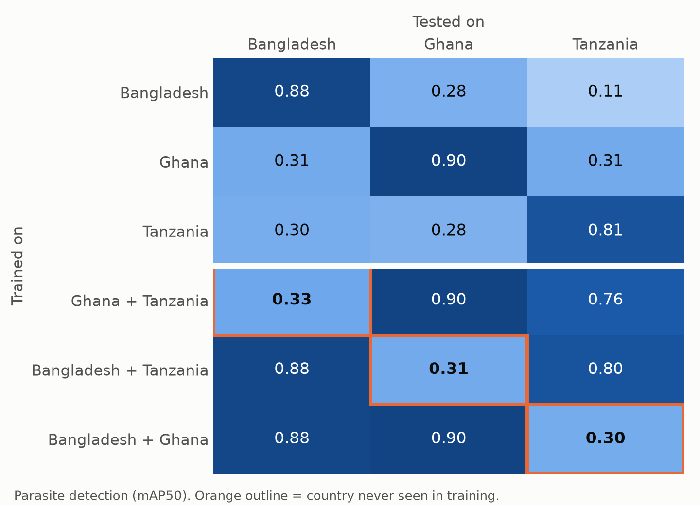
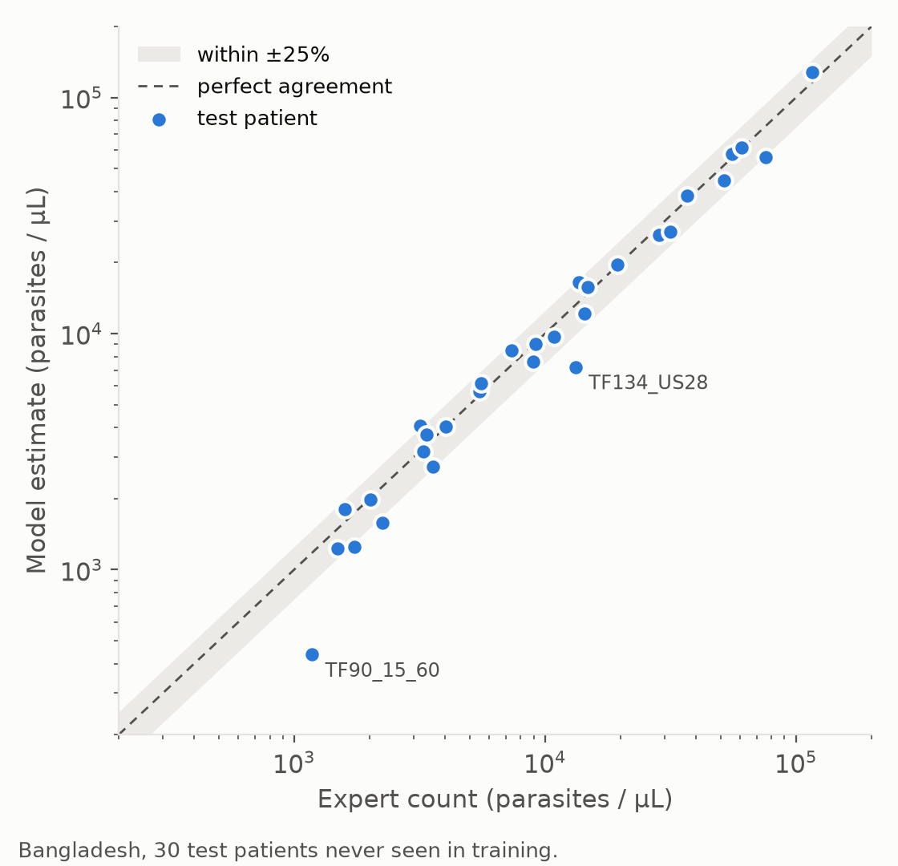
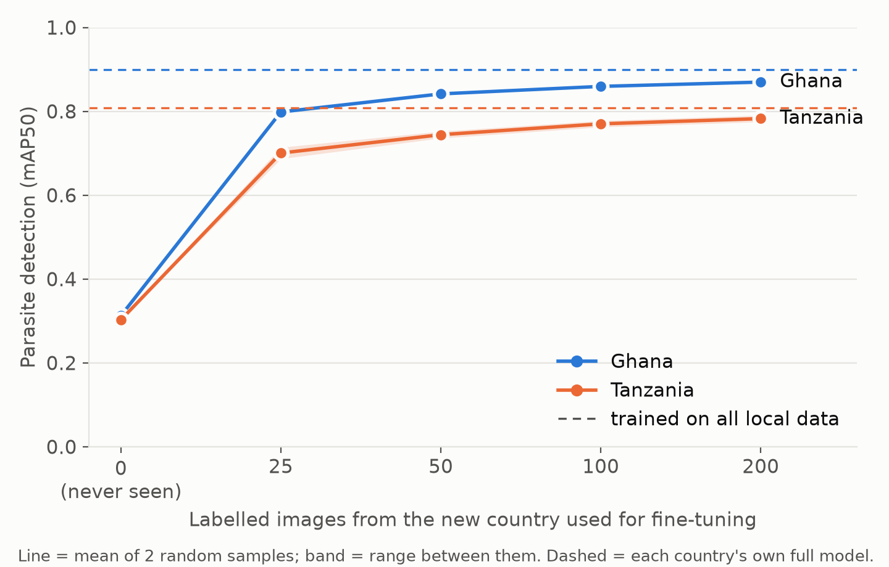

# Does a Malaria Parasite Counter Still Work in Another Country?

Malaria is still diagnosed mostly by a microscopist counting parasites on a stained blood smear. Parasite density, the number of parasites per microlitre of blood, guides treatment, but counting is slow, tiring and depends on who is counting, and many clinics have no trained microscopist at all. Deep-learning detectors can count parasites automatically, but they are usually trained and tested on images from a single hospital.

This project trains a parasite and white-blood-cell detector on thick blood smears from one hospital and tests it in two other countries, to answer three questions: how accurate is the parasite count at home, what happens in a new country, and how much local data is needed to fix it?

**Result:**

- **At home it works.** On 30 Bangladesh patients never seen in training, the model's parasite density is within a median **12%** of the expert count (95% CI 7–16%), and within ±25% for **80%** of patients.
- **In a new country it collapses.** Parasite detection falls from about **0.9** mAP50 at home to about **0.3** in a country the model has never seen. Parasite counts go wrong in *opposite* directions: about **2.8× too many** in Tanzania and about **one sixth** of the true number in Ghana.
- **More training countries do not fix it, and neither does re-tuning the confidence cut-off.** A model trained on two countries scores 0.30–0.33 on the third, the same as a model trained on one.
- **About 50 labelled local images do fix it.** Fine-tuning with 25 local images recovers about 80% of the lost accuracy; with 50 images, per-image counting error matches a model trained on all of that country's data (Tanzania 21% vs 22%; Ghana 12% vs 9–12%).



## Why this matters

AI microscopy is often proposed for exactly the settings where data are scarcest, such as rural clinics in Nigeria, which carries the largest share of the world's malaria burden. A model validated on one hospital's images can look ready for deployment while failing silently elsewhere, and this project shows the failure is not even in a predictable direction. The practical question is therefore not only "how accurate is the model?" but "what does a new site need to do before trusting it?". The answer found here is modest and actionable: label about 50 local images.

## Data

Three public thick-smear datasets, all Giemsa-stained, all photographed with a smartphone through a microscope, all labelled with parasites and white blood cells (WBCs).

| Country | Source | Images | Grouping | Notes |
|---|---|---:|---|---|
| Bangladesh | NIH/NLM, Chittagong Medical College Hospital (Yang et al., 2020) | 1,830 labelled photos | 150 patients | Parasites as circles, WBCs as points |
| Ghana | Lacuna / minoHealth AI Labs, Princess Marie Louise Children's Hospital, Accra (Harvard Dataverse, CC-BY-4.0) | 3,043 photos | none | Several phone cameras; a model assisted labelling |
| Tanzania | Morogoro Region (Zenodo 4314960, CC-BY-4.0) | 5,453 tiles from 611 photos | none | Empty tiles removed before release, so no uninfected images |

All patients in the Bangladesh set are infected, with densities from 283 to 124,080 parasites/µL. No images are redistributed in this repository; the notebooks download them from the original sources.

## Method

1. **Checking the data by eye before using it.** For each dataset, labels were drawn back onto the images. This caught a silent trap: phone photos carry a hidden "rotate" flag, and the **Bangladesh labels are in the stored (unrotated) frame while the Ghana labels are in the rotated frame**. Using the wrong frame puts every label on empty background. All images were re-saved without the flag.
2. **Matching the scale.** The datasets were photographed at different resolutions, so each was resized so that the median parasite is about 25 pixels across. WBC sizes after scaling agree within about 20% across sites (60, 69 and 73 px), an independent check that the scaling is right.
3. **Splits.** Bangladesh was split by **patient** (99 train, 21 val, 30 test), stratified by density. Ghana and Tanzania have no patient IDs, so they were split by **blocks of consecutive images** (30 for Ghana, 10 photos for Tanzania), which keeps photos from the same slide together. Ghana's training tiles were capped at 8,000 so no country dominates training.
4. **Detector.** YOLO11s (Ultralytics), pre-trained on everyday photos, fine-tuned on 640 × 640 tiles for up to 40 epochs. Six models were trained with identical settings, differing only in training data: each country alone, and each pair of countries.
5. **Parasite density.** The standard thick-smear method: parasites counted against WBCs, × 8,000 WBCs/µL. Whole photos are scored, not tiles, so no parasite is counted twice. The confidence cut-off (0.25) was chosen on validation patients only.
6. **Few-shot adaptation.** The model that had never seen a country was fine-tuned on 25, 50, 100 or 200 photos from that country (two random samples each, nested so that the 25 are inside the 50), and tested on that country's test set.

## Results

### 1. At home, density per patient is close to the expert count

30 Bangladesh test patients, cut-off 0.25 chosen on the 21 validation patients.

| Measure | Result | 95% CI (patient bootstrap) |
|---|---|---|
| Median absolute error | **12%** | 7–16% |
| Patients within ±25% | **80%** (24/30) | 67–93% |
| Typical ratio (model ÷ expert) | 0.91 | 0.83–0.99 |
| 95% agreement limits | 0.56× to 1.49× | |
| Same order-of-magnitude band | 27 of 30 | |

WBC counts are almost exact (for example 238 vs 238, 311 vs 313), so nearly all the error comes from parasites. There is a small but real underestimate of about 9%. The largest error is the patient with the fewest parasites (35 true, 13 found), where every miss matters most.



### 2. In a new country, detection collapses

Parasite detection (mAP50) for every model on every country's test set (figure at the top). At home all three countries reach 0.81–0.90. On a country never seen in training, every model scores 0.11–0.33. Training on two countries gives 0.30–0.33 on the third, no better than the best single country (0.28–0.31). WBCs transfer better than parasites, especially with two training countries (0.67–0.93 on the unseen country), so **parasites are the bottleneck**.

Pooling countries costs nothing: a model trained on Bangladesh + Ghana scores 0.88 on Bangladesh and 0.90 on Ghana, the same as each country's own model.

A quick colour test (Reinhard colour transfer of 1,000 Tanzania tiles to Bangladesh's colour statistics) doubled WBC detection (0.18 to 0.39) but made parasite detection worse (0.08 to 0.01): **the failure is not just stain colour.**

### 3. Counts go wrong in opposite directions

Per-photo (Tanzania, 111 test photos) or per-image (Ghana, 598 test images) parasite counts:

| Model | Cut-off | Tanzania: median error | Tanzania: total ratio | Ghana: median error | Ghana: total ratio |
|---|---|---:|---:|---:|---:|
| Never seen | 0.25 (from Bangladesh) | 204% | **2.80** | 95% | **0.17** |
| Never seen | re-tuned on local val | 58% | 1.26 | 63% | 0.68 |
| + 50 local images | re-tuned on local val | **21%** (17–27) | 1.03 | **12%** (10–14) | 0.93 |
| Home model | re-tuned on local val | 22% (18–25) | 1.12 | 9% (8–10) | 0.97 |

Sent unchanged, the model overcounts almost three-fold in Tanzania and finds a sixth of the parasites in Ghana, so no single correction factor could fix it. Re-tuning the cut-off helps but leaves large errors, and the best cut-offs sit at the edges of the range tried (0.75 and 0.05): the confidence scores themselves are miscalibrated.

### 4. About 50 local images close most of the gap



| Local images | Ghana mAP50 | Gap recovered | Tanzania mAP50 | Gap recovered |
|---:|---:|---:|---:|---:|
| 0 | 0.31 | 0% | 0.30 | 0% |
| 25 | 0.80 | 83% | 0.70 | 79% |
| 50 | 0.84 | 90% | 0.74 | 87% |
| 100 | 0.86 | 93% | 0.77 | 92% |
| 200 | 0.87 | 95% | 0.78 | 95% |
| Home model | 0.90 (2,113 images) | 100% | 0.81 (430 photos) | 100% |

The two random samples differ by at most 0.03 at every size. Returns diminish after about 50–100 images.

### 5. Blur drives the failure in Tanzania, not in Ghana

Image sharpness was measured as the variance of the Laplacian, ignoring the black area outside the microscope's field.

| Model | Error, blurriest third | Error, sharpest third | Spearman rho, focus vs error |
|---|---:|---:|---:|
| Tanzania, never seen | **153%** | 30% | −0.32 |
| Tanzania, + 50 local | 19% | 20% | 0.07 |
| Ghana, never seen | 57% | 71% | 0.07 |
| Ghana, + 50 local | 11% | 11% | 0.01 |

In Tanzania the unadapted model's overcount is concentrated in the blurriest photos, plausibly because blurred debris looks like parasites to a model that has never seen this site's image quality. After local fine-tuning, sharpness no longer predicts error. In Ghana the unadapted model is uniformly poor regardless of sharpness, pointing to a systematic difference in how parasites look or were labelled. A simple sharpness check could flag images for review before counting.

## Limitations

- **Labelling style differs between sites.** Each dataset was labelled by different people with different tools, and Ghana's labelling was model-assisted. Part of the cross-country "failure" may be disagreement between annotators rather than model error. Separating the two would need an expert to re-read a sample of slides.
- **Approximate patient splits for Ghana and Tanzania.** Blocks of consecutive images keep most of a slide together, but a patient could straddle two blocks, which would make those home scores slightly optimistic.
- **Per-image results are not independent.** Photos from the same patient are correlated, so the confidence intervals for Ghana and Tanzania are somewhat too narrow.
- **No uninfected patients were tested.** Tanzania's public release contains no empty images and all Bangladesh test patients are infected, so false alarms on healthy blood were not measured.
- **Single training run per configuration.** Differences of about ±0.03 mAP50 between models should not be over-read.
- **Forgetting was not measured.** The few-shot models were tested only on their new country.
- **Sharpness scores are comparable within a site, not between sites.** The Laplacian measure also responds to camera noise, compression and smear texture.
- **No Nigerian data.** The motivation is Nigerian clinics, but no public Nigerian thick-smear dataset with usable labels was found.

## Future work

- Expert re-annotation of a sample from each site, to separate model failure from labelling differences.
- Testing false alarms on the NIH uninfected patients.
- Proper stain normalisation and blur augmentation during training, compared against few-shot fine-tuning.
- Checking whether few-shot fine-tuning degrades performance on the original countries.
- Collecting a small labelled Nigerian set to test the 50-image recommendation where it is meant to apply.

## Repository structure

```text
.
├── notebooks/
│   ├── 01_explore_nlm_thick.ipynb   # Bangladesh: labels, orientation check, patient split, tiles
│   ├── 02_train_yolo_nlm.ipynb      # model A: trained on Bangladesh (Kaggle GPU)
│   ├── 03_explore_tanzania.ipynb    # Tanzania: labels, scale matching, test tiles
│   ├── 04_explore_ghana.ipynb       # Ghana: labels, orientation, per-camera scale
│   ├── 05_density_eval.ipynb        # density per Bangladesh patient; first cross-country tests
│   ├── 06_build_splits.ipynb        # block splits and tiles for Ghana and Tanzania
│   ├── 07a_train_sites.ipynb        # models B, C, D (Kaggle GPU)
│   ├── 07b_train_sites.ipynb        # models E, F (Kaggle GPU)
│   ├── 08_cross_site_eval.ipynb     # 6 models × 3 countries
│   ├── 09_few_shot.ipynb            # fine-tuning with 25–200 local images
│   ├── 10_counts.ipynb              # detections for count analysis
│   ├── 11_count_analysis.ipynb      # count error and image-quality analysis
│   └── 12_figures.ipynb             # figures (runs on a laptop)
├── results/
│   ├── cross_site_detection.csv
│   ├── few_shot_results.csv
│   ├── count_results.csv
│   ├── quality_vs_error.csv
│   ├── nlm_test_patient_density.csv
│   ├── fig1_cross_country_grid.png
│   ├── fig2_local_images.png
│   └── fig3_density_agreement.png
├── requirements.txt
└── README.md
```

## Reproducing

1. Notebooks 01–11 run on Kaggle; each one uses the saved output of earlier ones as an input. Notebooks 02, 05 and 07–10 need a GPU (a free T4 is enough); the others run on CPU.
2. The data are downloaded inside the notebooks from the original sources (NLM, Zenodo and Harvard Dataverse). No account or approval is needed.
3. Notebook 12 runs on a laptop from the CSVs in `results/`. `nlm_test_patient_density.csv` was rebuilt from the table printed by notebook 05.
4. Kaggle limits how many output files a notebook keeps; temporary copies of training tiles must be deleted before saving, or model files can be silently dropped.

## References

- Yang, F. et al. (2020). Deep learning for smartphone-based malaria parasite detection in thick blood smears. *IEEE Journal of Biomedical and Health Informatics*, 24(5). doi:10.1109/JBHI.2019.2939121. Data: U.S. National Library of Medicine.
- Ghana and Uganda malaria blood smear images (Lacuna project, minoHealth AI Labs and Makerere University). Harvard Dataverse, doi:10.7910/DVN/VEADSE; *Data in Brief* (2024), doi:10.1016/j.dib.2024.111190.
- Malaria blood smear image dataset, Tanzania. Zenodo, doi:10.5281/zenodo.4314960.
- Igwezeke, F. O. et al. (2026). MORPHA: Morphology-constrained training and the limits of cross-acquisition transfer in low-resource malaria microscopy. arXiv:2609.05990.
- Adeniji, S. A. et al. (2026). Investigating white blood cells as a source of false-positive malaria parasite detection in African blood-smear images. arXiv:2609.29663.
- Reinhard, E. et al. (2001). Color transfer between images. *IEEE Computer Graphics and Applications*, 21(5).
- Ultralytics YOLO11. https://github.com/ultralytics/ultralytics

## Author

Chinecherem Divine Mbah · [GitHub](https://github.com/Chichay317)
